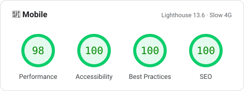
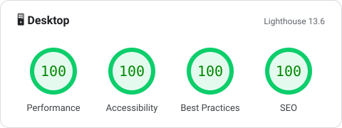

# Ristau · Handmade Crochet Kindle Covers

**Live:** [www.ristau.com.br](https://www.ristau.com.br)

A production landing page and product catalog for **Ristau**, a small Brazilian business that hand-crochets custom Kindle covers. I built it end to end: design, front end, content system, SEO, testing and deployment.

The site is in Portuguese for its real customers, but the main engineering goal was to let a **non-technical owner** run the whole catalog (products, photos, prices, testimonials, FAQ) by herself, while the site stays fast, accessible and easy to find on search engines.

[](#performance)
[](#performance)
[](#performance)
[](#performance)


## Performance

<p align="center">
  <a href="https://pagespeed.web.dev/analysis/https-www-ristau-com-br/f12xohrlqu?form_factor=mobile"></a>
  <a href="https://pagespeed.web.dev/analysis/https-www-ristau-com-br/f12xohrlqu?form_factor=desktop"></a>
</p>

| Core Web Vitals          | Mobile (Slow 4G) | Desktop |
| :----------------------- | :--------------: | :-----: |
| Largest Contentful Paint |      1.7 s       |  0.4 s  |
| First Contentful Paint   |      1.0 s       |  0.3 s  |
| Total Blocking Time      |       0 ms       |  0 ms   |
| Cumulative Layout Shift  |        0         |  0.016  |
| Speed Index              |      3.8 s       |  0.4 s  |

<p align="center"><sub>PageSpeed Insights · Lighthouse 13.6 · Nov 13, 2026 · <a href="https://pagespeed.web.dev/analysis/https-www-ristau-com-br/f12xohrlqu">full report →</a></sub></p>

## Highlights

- **Git-based CMS for a non-technical owner.** Content lives as YAML and images in the repo and is edited through a [Keystatic](https://keystatic.com) admin panel at `/admin`. In production each "Save" becomes a GitHub commit, and Vercel redeploys automatically. No database, no hosting bill for a backend.
- **Live preview inside the admin.** While editing a product or section, a floating preview shows the real page (desktop or mobile) and scrolls to the part being edited. It reuses the site's own components through a dedicated `/preview` route, so what the owner sees is what ships.
- **Custom admin fields.** A color picker, a BRL currency mask for prices, a position picker to reorder the hero carousel, and upload validation (PNG/WebP with transparency only, max 3 MB) so the owner can't break the page by accident.
- **Automated image pipeline.** A build step built on [sharp](https://sharp.pixelplumbing.com) reads each cover's alpha channel to find its opening and tilt, then composites a Kindle peeking out of it for the hero. Hero images and thumbnails are generated as resized WebP at build time, so the owner never has to optimize photos by hand.
- **Performance-focused.** Mostly static HTML with React only where interaction is needed (Astro islands), self-hosted and preloaded fonts, inlined CSS, mobile LCP tuning, and real-user monitoring with Vercel Speed Insights.
- **SEO and discoverability.** Schema.org structured data (Organization, Product catalog with offers, FAQ), sitemap, `robots.txt`, Open Graph image, and a generated `llms.txt` so AI assistants can describe the catalog accurately.
- **Accessible, touch-friendly hero.** The cover carousel supports swipe/drag, arrow keys and labeled controls, with smooth Motion animations.
- **Tested.** Unit and component tests with Vitest + Testing Library (price parsing, content loading, SEO output, carousel behavior, upload rules), plus Playwright end-to-end tests against the production build.

## Tech stack

| Area          | Tools                                                     |
| :------------ | :-------------------------------------------------------- |
| Framework     | Astro 7 (static + server routes), React 19 islands        |
| Language      | TypeScript                                                |
| Styling       | Tailwind CSS 4, Motion for animations                     |
| Content / CMS | Keystatic (local files in dev, GitHub storage in prod)    |
| Images        | Astro Assets, sharp (build-time compositing and resizing) |
| Testing       | Vitest, Testing Library, jsdom, Playwright                |
| Hosting       | Vercel (adapter, Analytics, Speed Insights)               |

## Architecture

```
src/
├── pages/          # index, /preview (admin live preview), llms.txt, robots.txt
├── layouts/        # base HTML layout, fonts, analytics
├── components/     # hero slider and page sections (React)
├── admin/          # custom Keystatic fields and the live preview panel
├── data/           # typed content loaders, price/color helpers, SEO and JSON-LD
├── content/        # CMS-managed YAML + images (one folder per cover)
└── styles/
scripts/            # build-time image generation (Kindle mockups, OG image)
tests/
├── unit/           # Vitest + Testing Library
└── e2e/            # Playwright
```

Content flows in one direction: **Keystatic → YAML/images in Git → typed loaders in `src/data` → components**. The site and the admin preview render from the same loaders and components, which keeps them in sync.

## Getting started

Requires Node.js 22+.

```bash
npm install
npm run dev        # http://localhost:4321, admin at /admin
```

| Command            | Description                                         |
| :----------------- | :-------------------------------------------------- |
| `npm run dev`      | Local dev server on `localhost:4321`                |
| `npm run build`    | Production build (output in `.vercel/output`)       |
| `npm test`         | Unit and component tests (Vitest)                   |
| `npm run test:e2e` | End-to-end tests (Playwright) against the build     |
| `npm run og -- a b c` | Regenerate the Open Graph image from 3 cover slugs |

## Editing content

All editable content lives in `src/content/` and is managed through the admin panel at `/admin` (or `/keystatic`):

- `src/content/capas/<slug>/index.yaml` + `image.(png|webp)`: one folder per cover
- `src/content/site.yaml`: brand, tagline, WhatsApp, Instagram, SEO and footer
- `src/content/home.yaml`: the "Handmade" and "How to order" sections

In development the panel writes directly to local files. In production every save is committed to GitHub and Vercel redeploys.

### Enabling the admin in production (one-time setup)

1. Temporarily set `storage` in `keystatic.config.tsx` to `{ kind: "github", repo: ... }` and run `npm run dev`.
2. Open `http://127.0.0.1:4321/keystatic` and follow the wizard to create the GitHub App. It writes `KEYSTATIC_GITHUB_CLIENT_ID`, `KEYSTATIC_GITHUB_CLIENT_SECRET`, `KEYSTATIC_SECRET` and `PUBLIC_KEYSTATIC_GITHUB_APP_SLUG` to `.env`.
3. Revert the change from step 1 and add the four variables to Vercel (Settings → Environment Variables).
4. In the GitHub App, add the production callback URL: `https://<domain>/api/keystatic/github/oauth/callback`.
5. Editors need a GitHub account with write access to the repository.

## Author

Built by **Christopher Alves** · [GitHub](https://github.com/christopher-alves-dev)
